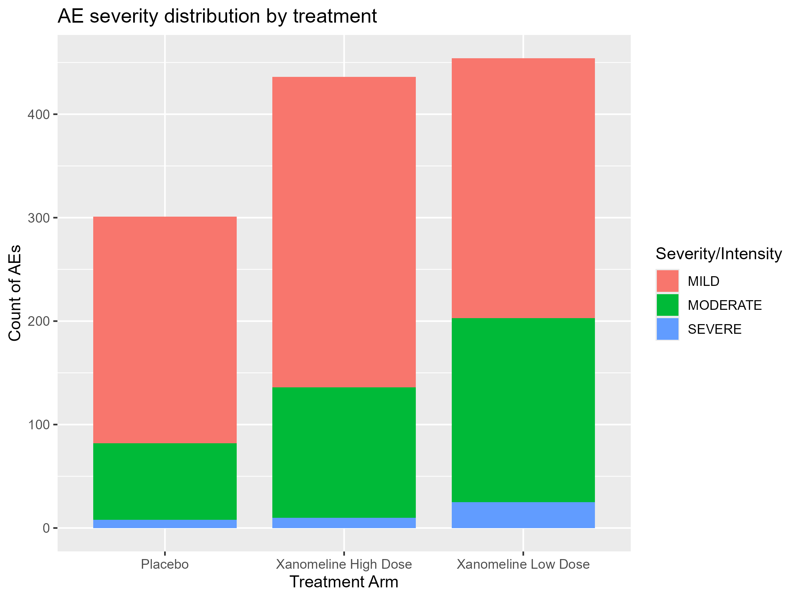
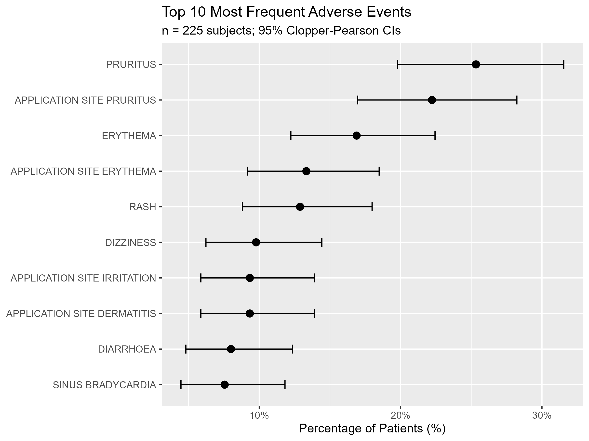

# pharmaverse programs

Clinical programming in R with [pharmaverse](https://pharmaverse.org/)
packages, from raw data to tables and figures, on the synthetic CDISC pilot
data in `{pharmaverseraw}`, `{pharmaversesdtm}` and `{pharmaverseadam}`.

| Folder / file | What it does | Key packages |
|---|---|---|
| [`descriptive_stats/`](descriptive_stats/README.md) | `descriptiveStats`, an R package of descriptive statistics written from first principles, with roxygen2 documentation and a testthat suite | `roxygen2`, `testthat` |
| `descriptive_stats_demo.R` | Builds, tests, checks and demonstrates the package | `devtools` |
| `sdtm/create_ds_domain.R` | SDTM Disposition (DS) domain from raw eCRF data, with study controlled terminology | `{sdtm.oak}` |
| `adam/create_adsl.R` | ADaM subject-level dataset (ADSL) with derived flags and imputed treatment datetimes, plus an independent QC re-derivation | `{admiral}` |
| `tlg/01_create_ae_summary_table.R` | Treatment-emergent AE summary table by SOC and preferred term | `{gtsummary}`, `{gt}` |
| `tlg/02_create_visualizations.R` | AE severity by treatment, and top 10 AEs with 95% Clopper-Pearson CIs | `{ggplot2}` |
| `tlg/03_create_listings.R` | AE listing | `{gt}` |
| `run_all.R` | Runs everything from scratch and writes a log | |

Each program's output is in the `output/` folder next to it.

## Highlights

* **`descriptiveStats` matches SAS when asked.** Quartiles support the
  Hyndman and Fan (1996) definitions used by default in R (type 7), SAS
  (`PCTLDEF=5`, type 2) and SPSS (type 6), and `describe_stats()` works like
  `PROC MEANS` with a `CLASS` statement. Grouped by planned arm, its age
  statistics match Table 14-2.01 of the CDISC pilot study, checked by a unit
  test.
* **Double programming in R.** `create_adsl.R` re-derives the
  study-specific variables (age groups, ITT, abnormal blood pressure and
  cardiac population flags, last known alive date) a second way in plain
  `{dplyr}`, without `{admiral}`, and compares them with the production
  dataset; treatment dates and imputation flags are compared with
  `pharmaverseadam::adsl`. The script prints a match count per variable: all
  306 subjects match.
* **Traceability.** Imputed treatment start times carry an imputation flag
  (`TRTSTMF`), and the SDTM program documents its raw-to-SDTM mapping in its
  header.
* **Checks stop the script.** The SDTM and ADSL programs fail with an error
  if a structural check fails (for example, one record per subject in ADSL),
  so a bad dataset is never written silently.

## Example outputs





## Run it

From the repository root:

```r
source("pharmaverse/run_all.R")   # everything, with a log in pharmaverse/run_all_log.txt
```

or one program at a time, e.g. `source("pharmaverse/adam/create_adsl.R")`.
`run_all.R` installs any missing packages first. On Windows, the package
check needs [Rtools](https://cran.r-project.org/bin/windows/Rtools/) for your
R version.
